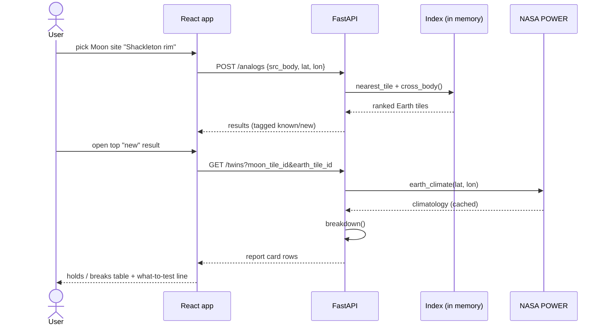
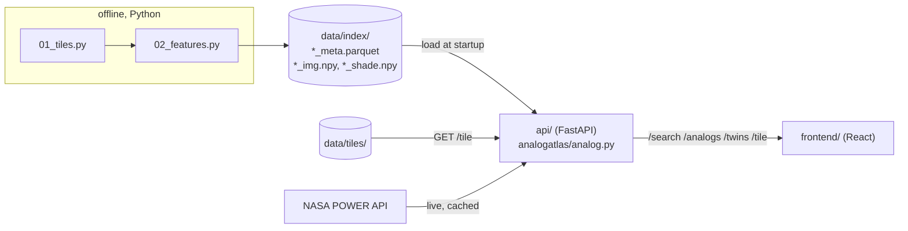

# Architecture

As of 14 Nov 2026. The contract the API, frontend and pipeline all build against, so three agents can work on them in parallel without drifting apart. If this doc and the code disagree, fix one to match the other — don't let them drift.

Related: [PLAN.md](PLAN.md) (status, decisions), [REQUIREMENTS.md](REQUIREMENTS.md) (what we must deliver).

## User flows

Three demo paths, screen by screen:

**1. Text search** — type a description → pick a body (Earth/Moon) → ranked tile results with thumbnails and scores.

**2. Site → Earth analogs** (the main story) — pick a Moon/Mars preset or click the map → ranked Earth tiles, each tagged `known` or new → open one.

**3. Report card** — from a result, open the twin comparison → dimension-by-dimension table (holds / breaks) → "what to test here" line.



## Stack

| Layer | Choice | Notes |
| --- | --- | --- |
| Frontend | React | Map library (Leaflet vs MapLibre) is [open](PLAN.md#open-decisions) — polar tiles need a separate projection either way |
| API | FastAPI | Thin wrapper around `analogatlas/analog.py`; the only part running Python while the app is live, because text queries need a CLIP vector |
| Pipeline | Python scripts + Earth Engine | Runs once, offline; writes `data/index/` |
| Hosting | Open | Frontend: Vercel or GitHub Pages. API: Hugging Face Spaces (index is ~15 MB) |

## Pages

| Page | Shows |
| --- | --- |
| Search | One map per body (tab or side-by-side), text box, image upload, preset-site dropdown |
| Results | Ranked cards: thumbnail, score, `known`/new tag, lat/lon |
| Report card | Dimension table from `/twins` (moon value, earth value, match 0–1, note), fixed Earth's-limits rows, "what to test here" |
| Close study | For the 2–3 chosen candidates: radar roughness comparison (Mini-RF vs RCM/Sentinel-1), higher-res imagery |

## Data contract

### API endpoints

All bodies are `"moon"` or `"earth"` (`"mars"` once scoped). Coordinates are `lat`/`lon` in degrees.

**`POST /search`** — rank tiles within one body by text or image.
```json
// request
{"body": "moon", "query": "a large impact crater with a central peak", "k": 12}
// response
{"results": [
  {"tile_id": "moon_6_12_34", "lat": -12.3, "lon": 45.0, "score": 0.82,
   "known_analog": null, "tile_url": "/tile/moon/img/moon_6_12_34.jpg"}
]}
```

**`POST /analogs`** — cross-body: Earth analogs for a Moon/Mars tile (or the reverse).
```json
// request
{"src_body": "moon", "lat": -89.5, "lon": 0.0, "k": 12, "w_phys": 0.3}
// response
{"src_tile": {"tile_id": "moon_6_0_90", "lat": -89.5, "lon": 0.0},
 "results": [
   {"tile_id": "earth_-77.50_162.00", "lat": -77.5, "lon": 162.0,
    "score": 0.74, "visual_cos_scaled": 0.91, "physical": 0.68,
    "known_analog": "McMurdo Dry Valleys, Antarctica"}
 ]}
```

**`GET /twins?moon_tile_id=&earth_tile_id=`** — the report card for one pair.
```json
{"moon": {"tile_id": "moon_6_0_90", "slope_med": 4.7, "relief_km": 1.2, "...": "..."},
 "earth": {"tile_id": "earth_-77.50_162.00", "slope_med": 5.1, "relief_km": 1.0},
 "climate": {"TS_MIN": -55.2, "TS_MAX": 8.1, "PRECTOTCORR": 0.02},
 "breakdown": [
   {"dimension": "Median slope", "moon": "4.7°", "earth": "5.1°", "match": 0.91,
    "note": "LOLA vs ETOPO, both ~1.9 km/px"},
   {"dimension": "Atmosphere", "moon": "vacuum", "earth": "1 bar", "match": 0.0,
    "note": "Cannot be reproduced on Earth"}
 ]}
```

**`GET /tile/{body}/{layer}/{tile_id}`** — tile image (`layer` is `img` or `shade`). A thin passthrough to `data/tiles/`; moves to static hosting once the app is deployed.

Errors: `4xx` with `{"detail": "..."}` (FastAPI default). Unknown `tile_id` → `404`.

### Index files (`data/index/`)

| File | Produced by | Format |
| --- | --- | --- |
| `{body}_meta.parquet` | `scripts/02_features.py` | One row per tile: `tile_id, body, lat, lon, lat_min/max, lon_min/max, slope_med, slope_p90, relief_km, elev_km`, plus Moon-only `rock_abundance, regolith_t_anom, t_max_k, t_min_k` |
| `{body}_img.npy` | `scripts/02_features.py` | `(N, 512)` float16, CLIP image embedding, L2-normalised |
| `{body}_shade.npy` | `scripts/02_features.py` | `(N, 512)` float16, CLIP hillshade embedding averaged over 4 rotations, L2-normalised |

`body` is `moon` or `earth` today. `moon_polar` would be added as a fourth, separate file set if the south-pole decision makes it core — see [Open decisions](#open-decisions-this-design-assumes) below.

`analog.load_index(body)` reads all three into one `BodyIndex`; the API loads both bodies once at startup and keeps them in memory (~15 MB total).

## Repo layout

```
analogatlas/   # search core + pipeline library (existing)
scripts/       # pipeline entry points (existing)
api/           # FastAPI app — new, this issue's sibling work
  main.py        # app factory, loads both BodyIndex at startup
  routers/       # search.py, analogs.py, twins.py, tile.py
frontend/      # React app — new
docs/
data/          # gitignored; rebuilt per machine (data/raw, data/tiles, data/index)
```

| Path | What it does |
| --- | --- |
| `analogatlas/config.py` | Paths, tile scale (~85 km), data endpoints, CLIP model choice |
| `analogatlas/tiles.py` | Builds the Moon (Trek WMTS) and Earth (GIBS WMS) tile grids at the same ground scale and downloads the tiles |
| `analogatlas/rasters.py` | Reads PDS3 IMG files and ETOPO; per-tile slope, relief, rock abundance, temperature |
| `analogatlas/embed.py` | CLIP image and text embeddings; rotation-averaged hillshades; text prompts averaged over templates |
| `analogatlas/analog.py` | Search, Earth–Moon matching, NASA POWER climate lookup, analog report card — what the API wraps |
| `analogatlas/sites.py` | Known Earth analog sites (tag results "known" or "new") and Moon/Earth preset sites |
| `scripts/01_tiles.py` | Step 1: tile grids and tile download |
| `scripts/02_features.py` | Step 2: physical features and embeddings, saved to `data/index/` |



## Quality bar

"Done" for this architecture means:

- `/search` and `/analogs` respond in well under 1 s for `k ≤ 20` against the full index (no network call; `/twins` makes one cached NASA POWER call, ~1 s uncached).
- Search quality checked against independent data: the LOLA-slope agreement already done for Moon text queries ([PLAN.md](PLAN.md#status)); precision@k once crater labels exist.
- Every API response the frontend renders has a test or a manual check against real `data/index/` output — no silent fallback to mock data once the real index is wired in.
- Frontend: both map flows and the report card render with no console errors, reachable with no login (checked in a private browser window, per [REQUIREMENTS.md R3](REQUIREMENTS.md)).
- 2–3 report cards complete end to end before feature freeze.

## Open decisions this design assumes

- **South pole (core vs. stretch, see [PLAN.md](PLAN.md#open-decisions)):** the Moon index above is cylindrical, ±60°. If the south pole becomes core, it adds a separate `moon_polar_*` file set on a polar-stereographic grid, not a reprojection of the existing one. The API's `body` field would gain `"moon_polar"`, and the frontend gains a second lunar map pane with its own projection. Nothing above needs to change to accommodate this later — it's additive.
- **Map library:** Leaflet vs MapLibre, still open. Either works for the equirectangular Moon/Earth maps; the polar pane (if built) needs a projection plugin regardless of choice.
- **Hosting:** left open above; doesn't affect the data contract.
