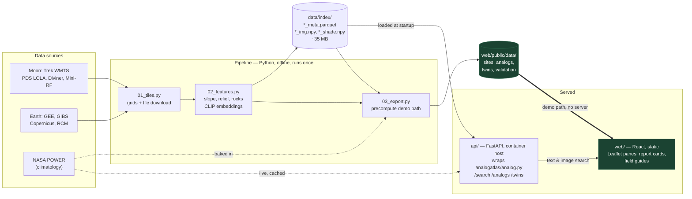
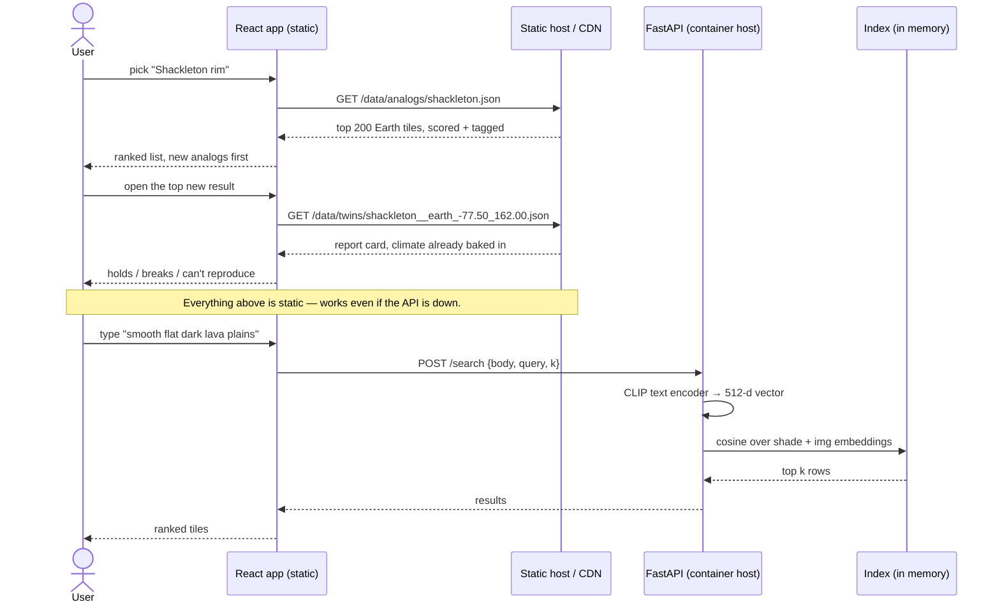

# Architecture

As of 14 Nov 2026. The contract the pipeline, API and frontend all build against, so three agents can work in parallel without drifting apart. If this doc and the code disagree, fix one to match the other — don't let them drift.

Related: [PLAN.md](PLAN.md) (status, decisions), [REQUIREMENTS.md](REQUIREMENTS.md) (what we must deliver), [RESOURCES.md](RESOURCES.md) (data sources).

**Rule:** before installing any library, check its current docs and pin exact versions. Don't trust remembered APIs.

## 1. Shape of the system

The Python pipeline does the heavy lifting **offline** and writes an index. Two things then read it:

- a **static export** that covers the whole demo path, so judging never depends on a live server;
- a **small FastAPI service** for the exploratory flows that genuinely need Python at request time (free-text and image search embed the query with CLIP).



The thick edge is the demo path: static files only. The thin edge is the part that needs a live server.

### Why the split, and what breaks without it

Free-text search *cannot* be static: "smooth flat dark lava plains" has to become a 512-d CLIP vector, which needs PyTorch. But the main demo story — a Moon base site → ranked Earth analogs → report card — is a **fixed set of presets** ([`analogatlas/sites.py`](../analogatlas/sites.py)), so every one of those answers can be precomputed.

| Flow | Needs the API? | Why |
| --- | --- | --- |
| Preset Moon/Mars site → Earth analogs | No, precomputed | ~21 presets (`MOON_BASE_REGIONS` + `MOON_SITES`) × top 200 Earth tiles is a small JSON |
| Report card for a precomputed pair | No, precomputed | Climate is baked in at export time (see §4) |
| Free-text query | **Yes** | CLIP text encoder |
| Image upload | **Yes** | CLIP image encoder |
| Arbitrary map click as the source tile | **Yes** | Any of ~17k tiles can be the source; precomputing all pairs is 17k × 11.7k |

This directly answers a requirement: [REQUIREMENTS.md](REQUIREMENTS.md#4-things-to-avoid) lists "a broken live demo at judging time" as a thing to avoid. With this split, the demo path is static files on a CDN — if the API is cold, asleep or broken, the story still lands and only free-text search degrades.

## 2. Stack

| Layer | Choice | Why |
| --- | --- | --- |
| Frontend | **React + TypeScript (strict)**, Vite | Decided in [PLAN.md](PLAN.md#decisions). Vite over Next.js: we have no SSR need — the export is static JSON and the map is client-only |
| Styling / UI | **Tailwind CSS + shadcn/ui** (Radix primitives), **lucide-react** icons | Accessible components that live in our repo and are customizable; no design system to invent under time pressure |
| Theme | Dark-first, light toggle | Planetary imagery reads best on dark |
| Map engine | **Leaflet** via `react-leaflet`, CRS EPSG:4326 | Decided in #24. NASA Trek (Moon) and our GIBS requests (Earth) are plain lat/lon tiles; Leaflet renders that CRS natively and its zoom-0 grid (2×1 tiles) is exactly Trek's. MapLibre only supports Web Mercator or globe. Two instances: one per body, loaded lazily |
| Score layer | Leaflet canvas renderer: the full tile grid as faint outlines, ranked results as circle markers coloured by a viridis-like ramp, with a legend | ~17k rectangles is small for one canvas. **deck.gl is not justified at this scale** |
| Earth basemap | **NASA GIBS** WMS/WMTS (Blue Marble, ASTER hillshade) | Already our tile source ([`config.py`](../analogatlas/config.py)); NASA's own imagery, which judges notice |
| Moon basemap | **NASA Moon Trek** WMTS (LROC WAC, LOLA hillshade) | Same layers the index is built from, so the map and the scores agree |
| Charts | **Recharts** (via shadcn/ui charts): radar + horizontal bars | Report card is a radar (per-dimension match) plus bars; matches the UI system |
| API | **FastAPI** + uvicorn, single process | Thin wrapper over [`analogatlas/analog.py`](../analogatlas/analog.py); loads the index once at startup |
| ML runtime | **PyTorch + open_clip**, `ViT-B-32` / `laion2b_s34b_b79k` | Already pinned in `config.py`; CPU is fine for one query vector |
| State | **Zustand** (app state) + URL query params | Every view is a shareable link: `/atlas?site=shackleton&w_phys=0.3&cell=earth_-77.50_162.00` |
| Content | **MDX** field guides for the 2–3 close-study sites | The brief explicitly asks us to document findings for a public audience |
| Tooling | **pnpm**, **Biome** (lint + format), **Vitest**, one **Playwright** smoke test | One tool for lint+format; smoke test guards the demo path |
| Hosting | **Google Cloud**: API on Cloud Run, frontend on Firebase Hosting. Domain: analogatlas.earth | [Decided](PLAN.md#decisions). How it deploys: [DEPLOY.md](DEPLOY.md) |

## 3. Pages

| Route | Purpose |
| --- | --- |
| `/` | **Atlas, the main explorer.** Three ways in: a preset site, a click anywhere on either map, or a text/picture search (results list, pick one to make it the source). Physical-weight slider (`w_phys`, needs the API), "new candidates only" toggle, lunar map switch (60°S–60°N or south pole). Two map panes: Earth left, Moon right. Report card on a candidate: both tiles side by side (imagery or terrain), per-dimension bars, **Holds / Breaks / Earth can't reproduce**, analog-model percentile, **what to test here**. Lookalike traps for the site below |
| `/sites` | Field-guide index: every lunar site, base regions first, with illumination, permanent shadow, radar CPR and trap count |
| `/sites/:id` | Field guide per site: the ground at 85 km (slope, relief, polar dimensions), Mini-RF radar CPR, plus the Earth radar number where the site has a close-study pair (#19), top 3 new Earth analogs with their field tests, lookalikes to avoid. Built from the static export alone |
| `/discoveries` | The close-study pairs first (#19), then the #29 model's top new candidates (not near any known site), with reasons, on a map; each links to the Atlas to find its lunar match |
| `/close-study/:id` | One close-study pair (#19): why it was picked and why it is new, radar roughness on both bodies (CPR vs CPR where RCM exists, otherwise the Sentinel-1 indicator, labelled), slopes at 1.9 km and 30 m, a Sentinel-2 picture, the full report card |
| `/traps` | Lookalike traps (#30): trap rate per lunar body, counts by reason, the strongest examples with image-only vs physics vs model ranks |
| `/methodology` | Scoring, the LOLA slope validation, **crater retrieval** and **where known analogs rank for their role** (#16), **hold-one-out validation** of the analog model, **what we rank on versus what we only report** (#32) — all from `validation.json` — and limitations |
| `/data` | Data sources, credits, and the AI-tool declaration ([R8](REQUIREMENTS.md#from-the-space-apps-rules) requires this) |

Tile pictures are not shipped: `web/src/lib/chips.ts` rebuilds each 85 km chip in the browser from the same NASA Moon Trek and GIBS services the index was built from (GIBS WMS for Earth; Trek WMTS tiles positioned and clipped for the Moon and the south pole).

### User flows

Three paths through those pages. The first is the demo; the other two are the exploratory ones that prove it's a real search engine and not a slideshow.


Green needs no server; amber needs the API.

The demo flow in full, showing exactly where each piece of data comes from:



## 4. Data contract

### 4.1 Index files (`data/index/`) — produced by the pipeline

| File | Produced by | Content |
| --- | --- | --- |
| `{body}_grid.parquet` | `scripts/01_tiles.py` | The tile grid before features: `tile_id, body, lat, lon, lat_min, lat_max, lon_min, lon_max` (+ `z, y, x` on the Moon, which are Trek WMTS tile coordinates) |
| `{body}_meta.parquet` | `scripts/02_features.py` | The grid columns plus features, below. One row per tile that has **both** layers on disk |
| `{body}_img.npy` | `scripts/02_features.py` | `(N, 512)` **float16**, CLIP imagery embedding, L2-normalised |
| `{body}_shade.npy` | `scripts/02_features.py` | `(N, 512)` **float16**, CLIP hillshade embedding: each tile is contrast-normalised (`embed.normalize_shade`), then averaged over four 90° rotations and re-normalised — so it encodes terrain *shape*, not sun azimuth or steepness |
| `{body}_craters.parquet` | `scripts/05_validate.py` | Lunar bodies only. Robbins crater counts per tile: `n_ge_1km, n_ge_5km, n_ge_20km, largest_km, per_1e4km2`, in `_meta.parquet` row order. **Held out** — never a search feature or a training label, which is what makes it usable as ground truth ([#16](https://github.com/FionaL7/AnalogAtlas/issues/16)). Saved so other machines need not download the 227 MB catalog |

Row order in the two `.npy` files matches `_meta.parquet` exactly. Nothing re-sorts them; `analog.BodyIndex` relies on this.

`{body}_order.json` (written by `scripts/02_features.py`) records the row count and a SHA-256 of the `tile_id` order. `load_index` refuses to load if the row counts differ or the order changed (`IndexMismatchError`). Older indexes without the file still load, with a warning.

**Feature columns in `_meta.parquet`:**

| Column | Bodies | Source | Meaning |
| --- | --- | --- | --- |
| `elev_km` | both | LOLA LDEM_16 / Copernicus DEM (Earth Engine) | Mean elevation |
| `relief_km` | both | same | 98th − 2nd percentile elevation within the tile |
| `slope_med`, `slope_p90` | both | same | Median and 90th-percentile slope, degrees |
| `rock_abundance` | moon | Diviner GDR L3 | Fractional rock cover; landing-hazard proxy |
| `regolith_t_anom` | moon | Diviner GDR L3 | Regolith temperature anomaly |
| `t_max_k`, `t_min_k` | moon | `rasters.lunar_temperature_model` | Modelled surface extremes vs latitude, **not** a direct measurement — say so in the UI |
| `t_max_k`, `t_min_k` | moon_polar | `rasters.polar_temperature_model` | Shadow-weighted blend of Diviner's cold-trap (<40 K) and sunlit-pole (~200 K) endpoints. The latitude fit **must not** be used here: it returns 0 K at the pole |
| `x_m`, `y_m`, `size_m` | moon_polar | polar grid | Cell centre and side, in metres from the pole. The polar map pane draws from these, not from lat/lon |
| `psr_frac` | moon_polar | LOLA `LPSR_75S_120M` | Fraction of the tile in permanent shadow |
| `avg_illum`, `illum_max` | moon_polar | LOLA `AVGVISIB_75S_120M` | Mean and best solar illumination over 18.6 years. `illum_max` is the siting number — an 85 km average dilutes a lit ridge away |
| `earth_vis` | moon_polar | LOLA `AVGVISIB_..._EARTH` | Fraction of time Earth is in line of sight, i.e. direct comms |
| `has_img` | moon_polar | NAC chip | Whether the chip has usable imagery; the NAC polar mosaic covers only 85.5–90°S and much of the pole is genuinely dark |
| `greenness`, `brightness` | earth | Blue Marble tile | Excess-green index and mean brightness |
| `lst_day_c`, `lst_night_c`, `lst_hot_c`, `lst_cold_c`, `lst_swing_c` | earth | MODIS LST 2015–24 (Earth Engine) | Surface temperature, °C: day/night mean, hottest day (p95), coldest night (p5), day−night swing |
| `precip_mm`, `aridity`, `solar_wm2` | earth | TerraClimate 2015–24 | Annual precipitation; precip/PET (capped at 10); mean shortwave. Unreliable in Antarctica |
| `ndvi` | earth | MODIS NDVI 2015–24 | Vegetation |
| `ice_frac`, `barren_frac`, `sparse_frac`, `veg_frac`, `water_frac`, `urban_frac` | earth | MODIS MCD12Q1 2023 | Land-cover fractions; `sparse_frac` = open shrubland + grassland (desert scrub), `veg_frac` = forest, savanna, crops. `ice_frac` flags ice sheets, which look like smooth lunar plains but aren't rock |
| `access_min` | earth | Oxford/MAP accessibility 2015 | Travel time to the nearest city, minutes (10th percentile in the tile = its most reachable part). NaN = no data (mostly Antarctica) |
| `lst_mean_c` | earth | MODIS LST 2015–24 | Mean of the day and night means, °C. Below 0 = frozen ground: the Earth side of Mars ground ice ([#39](https://github.com/FionaL7/AnalogAtlas/issues/39)) |
| `albedo` | earth | MODIS MCD43A3 2020–22 (Earth Engine) | White-sky shortwave albedo, 0–1. Compared with TES albedo on Mars. Seasonal snow is in the mean |
| `dust_aod` | earth | MERRA-2 `DUEXTTAU` 2020–22 (Earth Engine) | Dust optical depth at 550 nm, one field a day (12 UTC). Dust in the air, set against dust on the ground on Mars (TES dust cover index): a stand-in, not the same quantity |

`moon_polar` has no `rock_abundance` or `regolith_t_anom`: the Diviner cylindrical products stop at ±60°. `breakdown()` already guards on the column being present, so those rows are simply absent rather than faked.

Slope and relief are comparable across bodies **by construction**: LOLA LDEM_16 is 1.9 km/px and the Earth DEM (Copernicus GLO-30) is resampled to 1.85 km/px in Earth Engine, so both are measured at the same baseline. This is the sentence to put on the methodology page.

**Scale:** Moon ~5,376 tiles (±60°), `moon_polar` 89 tiles (75–90°S), Earth ~11.7k land tiles. Embeddings are ~5.5 MB per Moon matrix, ~90 KB per polar matrix and ~12 MB per Earth matrix — **~35 MB total**, which fits comfortably in a small container (512 MB is plenty alongside PyTorch).

Slope and relief stay comparable across all three: the polar DEM is 240 m/px, block-averaged by 8 to a 1.92 km baseline before slope is measured, against LOLA LDEM_16's 1.9 km and Earth's 1.85 km. `terrain_stats(..., spacing_m=)` is the one implementation all three go through.

### 4.2 Static export (`web/public/data/`) — produced by `scripts/03_export.py`

Gitignored. Built at deploy time from `data/index/` (the `data` release), then bundled with the frontend.

| File | Content |
| --- | --- |
| `sites.json` | Targets and known Earth analogs from [`sites.py`](../analogatlas/sites.py) — `MOON_BASE_REGIONS` (the Artemis candidate regions, the ones that answer "permanent Moon base"), `MOON_SITES`, `EARTH_PRESETS`, `KNOWN_EARTH_ANALOGS`: id, body, name, lat/lon, blurb, Trek tile URL. See [TARGET-SITES.md](TARGET-SITES.md) |
| `dimensions.json` | Dimension ids, labels, notes, and which ones are "Earth can't reproduce" |
| `tiles/{body}.json` | Per-tile geometry + features for the map layer: `tile_id, lat, lon, bbox, slope_med, relief_km`, and `known_analog` on Earth |
| `analogs/{site_id}.json` | Precomputed top ~200 Earth analogs for one preset: `tile_id, score, visual_cos_scaled, physical, known_analog, model_score` (#29 percentile, `null` until trained) |
| `twins/{site_id}__{tile_id}.json` | Precomputed report card for the pairs the demo opens, **climate baked in** so no NASA POWER call is needed at judging time. Also `field_tests` and `model_score`, as in `/twins` |
| `validation.json` | How the search scores against data that enters nothing else, copied from `data/index/`. Keys: `crater_retrieval` — precision@k over Robbins crater labels (density terciles and big craters), against the chance rate; `known_analog_ranking` — where each known analog ranks out of all Earth tiles, queried from lunar sites sharing its role (`sites.MOON_ROLE_SITES`), under the shipped scoring and image-only, with `moon_target: false` on Mars analogs that are reported but not scored; `polar_analog_ranking` — the canonical polar analogs per Artemis region ([#32](https://github.com/FionaL7/AnalogAtlas/issues/32)); `analog_model` — the #29 hold-one-out check. `05_validate.py` and `04_train.py` each merge their own keys, so neither clobbers the other |
| `traps.json` | **Lookalike traps** (#30): Earth tiles an image-only AI would pick (top hillshade similarity) that fail a physics check. `stats`: per lunar body, `trap_rate` = share of the top-20 lookalikes that are traps, plus counts per reason. `traps`: the strongest, one per Earth tile. `by_site`: traps per preset site. Each trap has `visual_rank` (image-only), `physics_rank` (where our search, cross_body, puts it; it pushes ice, plants and water down, see #33), `model_score_pct` (#29 model, environment-aware), and `breakers` with a plain-language `reason` (ice, vegetation, water, wet climate, slope, relief). Built by `analogatlas/traps.py` |
| `candidates.json` | `{moon, mars, all}`: the #29 model's top new candidates, copied from `data/index/candidates_*.json` (`tile_id, lat, lon, score_pct, why, slope_med, barren_frac, precip_mm, access_min`) |
| `radar.json` | Mini-RF CPR per lunar site (#17), keyed by site id: `cpr_median, cpr_p90, coverage, n_pixels, box_half_km, source`. From `data/index/moon_site_cpr.json` |
| `portfolio/{site_id}.json` | **Analog portfolio** (#31), one per lunar target: the fewest Earth sites that together cover 7 dimensions (terrain shape, slope and relief, thermal swing, dryness, low sun angle, bare rock (frozen at the pole), access). `dimensions`: `threshold`, `earth_best`, `covered_by`, and `earth_best_only` when no Earth site reaches the bar, so the best Earth can do counts. `sites`: picks in order, each with `covers`, `adds` and all 7 `scores`. `best_single_site`: how many dimensions one site covers alone. Ice, plant and water tiles are never picked. Built by `analogatlas/portfolio.py` (greedy set cover) |
| `close_study.json` | The #19 pairs: `id, site_id, earth_tile_id, earth_name, headline, why_picked, rank_among_new, nearest_known, radar{moon, earth_cpr, earth_s1}, earth_slope_30m, picture, twin`. Each radar stat has `measure`: `cpr` or `s1_vh_vv` (never compare the two). The same block is added as `close_study` to that pair's `twins/*.json`. Pictures in `close_study/*.jpg`. From `data/index/close_study.json` (`scripts/04_radar.py close-study`) |

`known_analog` comes from `analog.known_analog_name(lat, lon)` (150 km radius). Tiles where it's `null` are the **new** candidates — what the challenge actually asks for, so the UI leads with them.

### 4.3 API (FastAPI)

`body` is `"moon"` or `"earth"`. Coordinates are degrees. Errors are `{"detail": "..."}`; unknown `tile_id` → `404`.

**`POST /search`** — rank tiles within one body by text or image.
```json
// request  (exactly one of query / image_b64)
{"body": "moon", "query": "a large impact crater with a central peak", "k": 12, "w_shade": 0.6}
// response
{"results": [
  {"tile_id": "moon_6_12_34", "lat": -12.3, "lon": 45.0, "score": 0.82,
   "known_analog": null, "tile_url": "https://.../tile/moon/img/moon_6_12_34.jpg"}
]}
```
`w_shade` mixes hillshade vs imagery similarity (default 0.6, from `analog.search`).

**`POST /analogs`** — cross-body: Earth analogs for a Moon tile, or the reverse.
```json
// request
{"src_body": "moon", "lat": -89.5, "lon": 0.0, "k": 12, "w_phys": 0.3, "new_only": false}
// response
{"src_tile": {"tile_id": "moon_6_0_90", "lat": -89.5, "lon": 0.0},
 "results": [
   {"tile_id": "earth_-77.50_162.00", "lat": -77.5, "lon": 162.0,
    "score": 0.74, "visual_cos_scaled": 0.91, "physical": 0.68,
    "known_analog": "McMurdo Dry Valleys, Antarctica", "model_score": 0.97}
 ]}
```
`w_phys` weights physical closeness against visual similarity (default 0.3). `score` mixes a standardised visual score with physical closeness, so **it is not a 0–1 similarity** — show `visual_cos_scaled` (a 0–1 percentile) and `physical` in the UI, not the raw `score`.

Earth tiles that fail the ice, plant or water checks (`analogatlas/checks.py`, shared with traps) are pushed down by `w_phys × 8` ([#33](https://github.com/FionaL7/AnalogAtlas/issues/33)). At `w_phys=0` there is no push-down: that's the pure image-only ranking. Tiles without environment data are not penalised.

**`GET /twins?src_tile_id=&earth_tile_id=&src_body=`** — the report card for one pair. `src_body` is `moon` (default) or `moon_polar`.
```json
{"moon": {"tile_id": "moon_6_0_90", "slope_med": 4.7, "relief_km": 1.2, "t_min_k": 50.0},
 "earth": {"tile_id": "earth_-77.50_162.00", "slope_med": 5.1, "relief_km": 1.0},
 "climate": {"TS_MIN": -55.2, "TS_MAX": 8.1, "PRECTOTCORR": 0.02, "ALLSKY_SFC_SW_DWN": 3.1},
 "breakdown": [
   {"dimension": "Median slope", "moon": "4.7°", "earth": "5.1°", "match": 0.91,
    "note": "LOLA vs Copernicus DEM, both ~1.9 km/px", "kind": "compare"},
   {"dimension": "Atmosphere", "moon": "vacuum (trace exosphere)", "earth": "1 bar at sea level",
    "match": 0.0, "note": "No air: no convective cooling and no wind. ...", "kind": "earth_limit"}
 ],
 "field_tests": {
   "tests": [{"title": "Rover mobility and traverse planning", "risk": "Getting stuck or tipping on slopes",
              "detail": "...", "based_on": ["Median slope", "Local relief"], "strength": 0.83}],
   "avoid": [{"dimension": "Dryness", "reason": "Dryness breaks down here (...)"}]},
 "model_score": 0.97}
```
`field_tests` answers C6 ("how studying the Earth site helps"). Rules in `analogatlas/fieldtest.py`: each test names the rows it rests on and needs all of them to hold; `avoid` lists compare rows that break down, plus polar caveats.
`breakdown` rows come straight from `analog.breakdown()`. Each row has a `kind`:
- `compare`: measured on both bodies; `match` is `0..1`.
- `no_equivalent`: Moon only (e.g. Diviner rock abundance); `match` is `null`.
- `earth_limit`: Earth cannot reproduce it; `match` is always `0`. The fixed rows: Atmosphere, Gravity, Radiation, Magnetic field, Day/night cycle, Regolith dust.

**Group by `kind`, not by `match`.** A real comparison can score 0 without being an Earth limit. `scripts/03_export.py` derives `dimensions.json` from `breakdown()` and carries `kind` into it and the pre-computed report cards.

**`GET /tile/{body}/{layer}/{tile_id}`** — tile image, `layer` ∈ `img | shade`. Passthrough to `data/tiles/` in local dev; in production the frontend points at object storage directly and the API doesn't serve images.

### 4.4 Parity

Python is the single source of truth for every score. The browser does no scoring — it renders precomputed values or API responses. A Vitest fixture holds a handful of rows exported from Python so the frontend's formatting and grouping can be tested without a live API.

## 5. Repo layout

```
analogatlas/     search core + pipeline library (existing)
  config.py        paths, ~85 km tile scale, endpoints, CLIP model choice
  tiles.py         Moon (Trek WMTS) + Earth grids at equal ground scale; tile download
  earth_ee.py      Earth Engine: Copernicus DEM hillshade tiles + per-tile slope/relief
  rasters.py       PDS3 IMG reader (+ ETOPO offline fallback); per-tile slope, relief, rock abundance, temperature
  embed.py         CLIP image/text embeddings; rotation-averaged hillshades; prompt ensembling
  analog.py        search, cross-body matching, NASA POWER lookup, report card  ← what the API wraps
  sites.py         known Earth analogs (known/new tagging) + Moon/Earth presets; role → lunar query sites
  portfolio.py     fewest Earth sites covering every dimension of a lunar target (#31)
  closestudy.py    the close-study pairs and why each one is new (#19)
  craters.py       Robbins crater labels per tile — validation ground truth only, never a feature
scripts/
  01_tiles.py      step 1: grids + tile download
  02_features.py   step 2: features + embeddings → data/index/
  03_export.py     step 3: static export → web/public/data/   (to write)
  04_train.py      step 4: analog model, hold-one-out, new candidates (#29)
  04_radar.py      radar roughness: Mini-RF download, per-site CPR, RCM search (#17, #18)
  05_validate.py   step 5: crater retrieval + known-analog ranking → validation.json (#16)
  05_portfolio_figure.py  slide figure docs/figures/portfolio.png (#31)
api/               FastAPI — to write
  main.py            app factory; loads both BodyIndex at startup
  routers/           search.py, analogs.py, twins.py, tile.py
web/               React + Vite — to write
  src/components/    map/, panels/, charts/, ui/ (shadcn)
  src/lib/           data loading, store, url-state
  content/sites/     MDX field guides
  public/data/       static export (§4.2)
docs/
data/              gitignored: raw/ tiles/ index/
```

## 6. Quality bar

**Performance**
- `/search` and `/analogs` under 300 ms for `k ≤ 20` once warm (pure NumPy over a 35 MB in-memory index, no network).
- `/twins` under ~1.2 s cold, sub-millisecond warm — one NASA POWER call, `lru_cache`d at 512 entries.
- Map holds 60 fps panning with the full Earth score layer.
- First load ships no PyTorch and no embeddings; map code is dynamically imported.
- API cold start is the main risk on any scale-to-zero host — keep one instance warm during judging, and remember the static demo path doesn't touch the API at all.

**Correctness**
- Row-order parity between `_meta.parquet` and the `.npy` files is asserted in the pipeline, not assumed.
- Search quality checked against independent data: the LOLA slope agreement already done ([PLAN.md](PLAN.md#status)), precision@k once crater labels exist, and known analogs must rank in the top percentile for their known role.
- `t_max_k` / `t_min_k` are labelled as modelled, not measured, everywhere they appear.

**Accessibility and presentation**
- Keyboard-navigable controls (Radix), colour-blind-safe sequential palette (viridis/cividis-like) with a legend, never colour alone — every value is also in the panel.
- `prefers-reduced-motion` respected.
- Responsive: full two-pane explorer on desktop, bottom-sheet panels on mobile.
- Open Graph images per field guide; URL state is shareable.

**Testing and delivery**
- Vitest: data loaders, score formatting, report-card grouping.
- One Playwright smoke test covering the demo path: load `/atlas` → pick a preset → click a tile → report card renders.
- Every link reachable with no login, checked in a private window ([R3](REQUIREMENTS.md#from-the-space-apps-rules)).
- 2–3 report cards complete end to end before feature freeze.

## 7. Failure modes

| Failure | Effect | Mitigation |
| --- | --- | --- |
| API cold or down at judging | Free-text and image search fail | Demo path is static; show a clear "search unavailable" state, not a crash |
| NASA POWER slow or rate-limited | `/twins` hangs | 60 s timeout + `lru_cache`; precomputed `twins/*.json` for demo pairs needs no call |
| GIBS or Trek tile outage | Map tiles blank | Tiles for the demo sites are already on disk → serve them from our own object storage |
| Earth index not finished in time | No cross-body search at all — the critical milestone | The GIBS + ETOPO fallback path already works and 2,294 tiles exist; it can carry the demo at reduced coverage |
| Embeddings and meta rows drift out of order | Silently wrong analogs, hardest bug to spot | Assert equal lengths and a checksum on `tile_id` order at load time |
| `score` shown as if it were a similarity | Overclaims a match, costs Validity | UI shows `visual_cos_scaled` and `physical`; raw `score` is for ranking only |

## 8. Open decisions this design assumes

- **South pole: decided core and built** ([#6](https://github.com/FionaL7/AnalogAtlas/issues/6), [#26](https://github.com/FionaL7/AnalogAtlas/issues/26)). The Moon index above is cylindrical, ±60°; the pole is a separate `moon_polar_*` file set on a south polar stereographic grid — *not* a reprojection of the existing one — with `"moon_polar"` as a third `body` value and its own map pane. As predicted, this was purely additive: `cross_body` and `load_index` needed no changes.
- **How much Mars:** `sites.json` and the `body` field already allow Mars presets; a Mars index would follow the Moon's file pattern exactly.
- **Map library: decided, Leaflet** (#24). The polar pane uses a custom Leaflet CRS (`web/src/lib/polar.ts`) rather than proj4leaflet — the spherical stereographic forward/inverse is six lines, so two dependencies bought nothing. It mirrors `tiles.sp_forward`/`sp_inverse`, and `web/src/__tests__/polar.test.ts` checks the two agree.
- **Hosting: decided** ([PLAN.md](PLAN.md#decisions)). Google Cloud: API on Cloud Run, frontend on Firebase Hosting at analogatlas.earth ([DEPLOY.md](DEPLOY.md)).
