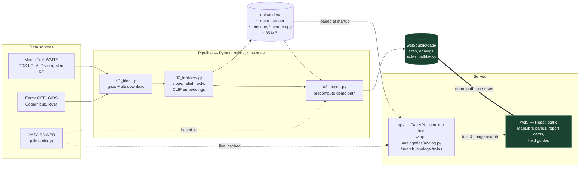
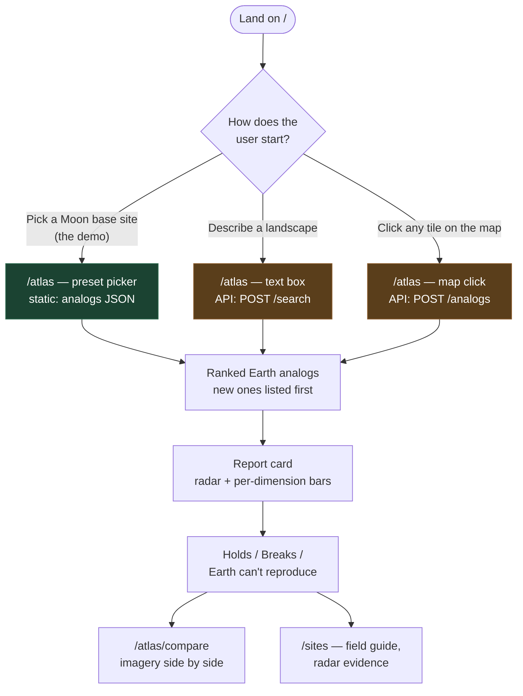
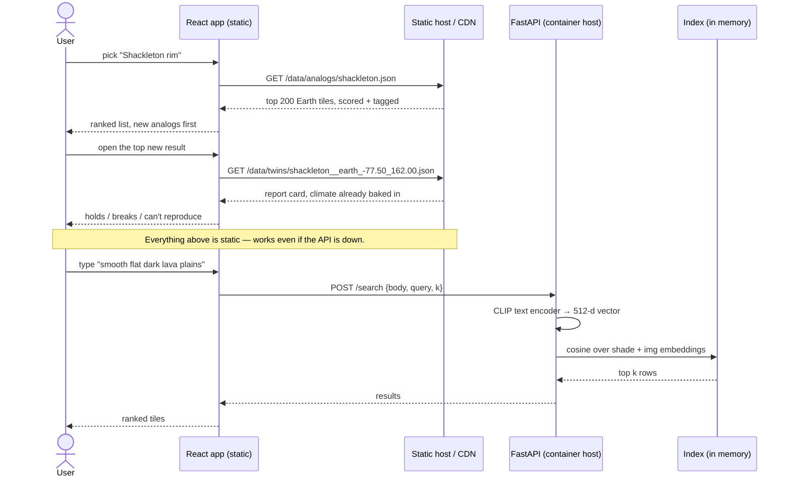

# Architecture

As of 14 Nov 2026. The contract the pipeline, API and frontend all build against, so three agents can work in parallel without drifting apart. If this doc and the code disagree, fix one to match the other — don't let them drift.

Related: [PLAN.md](PLAN.md) (status, decisions), [REQUIREMENTS.md](REQUIREMENTS.md) (what we must deliver), [RESOURCES.md](RESOURCES.md) (data sources).

**Rule:** before installing any library, check its current docs and pin exact versions. Don't trust remembered APIs.

## 1. Shape of the system

The Python pipeline does the heavy lifting **offline** and writes an index. Two things then read it:

- a **static export** that covers the whole demo path, so judging never depends on a live server;
- a **small FastAPI service** for the exploratory flows that genuinely need Python at request time (free-text and image search embed the query with CLIP).



The thick edge is the demo path: static files only. The thin edge is the part that needs a live server.

### Why the split, and what breaks without it

Free-text search *cannot* be static: "smooth flat dark lava plains" has to become a 512-d CLIP vector, which needs PyTorch. But the main demo story — a Moon base site → ranked Earth analogs → report card — is a **fixed set of presets** ([`analogatlas/sites.py`](../analogatlas/sites.py)), so every one of those answers can be precomputed.

| Flow | Needs the API? | Why |
| --- | --- | --- |
| Preset Moon/Mars site → Earth analogs | No, precomputed | ~21 presets (`MOON_BASE_REGIONS` + `MOON_SITES`) × top 200 Earth tiles is a small JSON |
| Report card for a precomputed pair | No, precomputed | Climate is baked in at export time (see §4) |
| Free-text query | **Yes** | CLIP text encoder |
| Image upload | **Yes** | CLIP image encoder |
| Arbitrary map click as the source tile | **Yes** | Any of ~17k tiles can be the source; precomputing all pairs is 17k × 11.7k |

This directly answers a requirement: [REQUIREMENTS.md](REQUIREMENTS.md#4-things-to-avoid) lists "a broken live demo at judging time" as a thing to avoid. With this split, the demo path is static files on a CDN — if the API is cold, asleep or broken, the story still lands and only free-text search degrades.

## 2. Stack

| Layer | Choice | Why |
| --- | --- | --- |
| Frontend | **React + TypeScript (strict)**, Vite | Decided in [PLAN.md](PLAN.md#decisions). Vite over Next.js: we have no SSR need — the export is static JSON and the map is client-only |
| Styling / UI | **Tailwind CSS + shadcn/ui** (Radix primitives), **lucide-react** icons | Accessible components that live in our repo and are customizable; no design system to invent under time pressure |
| Theme | Dark-first, light toggle | Planetary imagery reads best on dark |
| Map engine | **MapLibre GL JS** via `react-map-gl/maplibre` | Open source, raster + vector, and GPU fill layers handle our ~17k tile polygons smoothly. Two instances: one per body |
| Score layer | MapLibre GeoJSON source + `fill` layer, color from a data-driven expression | ~17k rectangles is small. **deck.gl is not justified at this scale** — it was sized for 600k H3 hexes, which we don't have |
| Earth basemap | **NASA GIBS** WMS/WMTS (Blue Marble, ASTER hillshade) | Already our tile source ([`config.py`](../analogatlas/config.py)); NASA's own imagery, which judges notice |
| Moon basemap | **NASA Moon Trek** WMTS (LROC WAC, LOLA hillshade) | Same layers the index is built from, so the map and the scores agree |
| Charts | **Recharts** (via shadcn/ui charts): radar + horizontal bars | Report card is a radar (per-dimension match) plus bars; matches the UI system |
| API | **FastAPI** + uvicorn, single process | Thin wrapper over [`analogatlas/analog.py`](../analogatlas/analog.py); loads the index once at startup |
| ML runtime | **PyTorch + open_clip**, `ViT-B-32` / `laion2b_s34b_b79k` | Already pinned in `config.py`; CPU is fine for one query vector |
| State | **Zustand** (app state) + URL query params | Every view is a shareable link: `/atlas?site=shackleton&w_phys=0.3&cell=earth_-77.50_162.00` |
| Content | **MDX** field guides for the 2–3 close-study sites | The brief explicitly asks us to document findings for a public audience |
| Tooling | **pnpm**, **Biome** (lint + format), **Vitest**, one **Playwright** smoke test | One tool for lint+format; smoke test guards the demo path |
| Hosting | **Google Cloud** (Fiona's Earth Engine project): API on Cloud Run. Domain: marsneedsmaps.space | [Decided](PLAN.md#decisions). Frontend host and CD pipeline get settled when deploying ([#21](https://github.com/FionaL7/AnalogAtlas/issues/21)) |

## 3. Pages

| Route | Purpose |
| --- | --- |
| `/` | Landing. Moon globe with the top analog tiles glowing, one-line pitch, CTAs "Explore the Atlas" / "Read the Field Guides" |
| `/atlas` | **Main explorer.** Left: body + preset-site picker, weight slider (`w_phys`), "new analogs only" toggle, text/image search box. Center: two map panes (Moon source ↔ Earth scores). Right, on tile click: report card — radar vs. target, per-dimension bars, **Holds / Breaks / Earth can't reproduce** lists, nearest known analog, "Compare imagery" |
| `/atlas/compare` | Synced split view: Earth tile imagery (GIBS) ↔ the Moon target's Trek tile, with a key-numbers table |
| `/sites/[slug]` | Field guide per close-study site (MDX): the story, radar roughness evidence (Mini-RF vs RCM), what matches, what breaks, how it helps Artemis |
| `/method` | Methodology: scoring math, the **LOLA slope validation** and precision@k, known-analog ranking check, Earth's limits |
| `/data` | Data sources, credits, and the AI-tool declaration ([R8](REQUIREMENTS.md#from-the-space-apps-rules) requires this) |

### User flows

Three paths through those pages. The first is the demo; the other two are the exploratory ones that prove it's a real search engine and not a slideshow.



Green needs no server; amber needs the API.

The demo flow in full, showing exactly where each piece of data comes from:



## 4. Data contract

### 4.1 Index files (`data/index/`) — produced by the pipeline

| File | Produced by | Content |
| --- | --- | --- |
| `{body}_grid.parquet` | `scripts/01_tiles.py` | The tile grid before features: `tile_id, body, lat, lon, lat_min, lat_max, lon_min, lon_max` (+ `z, y, x` on the Moon, which are Trek WMTS tile coordinates) |
| `{body}_meta.parquet` | `scripts/02_features.py` | The grid columns plus features, below. One row per tile that has **both** layers on disk |
| `{body}_img.npy` | `scripts/02_features.py` | `(N, 512)` **float16**, CLIP imagery embedding, L2-normalised |
| `{body}_shade.npy` | `scripts/02_features.py` | `(N, 512)` **float16**, CLIP hillshade embedding, mean over four 90° rotations then re-normalised — so it encodes terrain *shape*, not sun azimuth |

Row order in the two `.npy` files matches `_meta.parquet` exactly. Nothing re-sorts them; `analog.BodyIndex` relies on this.

**Feature columns in `_meta.parquet`:**

| Column | Bodies | Source | Meaning |
| --- | --- | --- | --- |
| `elev_km` | both | LOLA LDEM_16 / ETOPO 60s | Mean elevation |
| `relief_km` | both | same | 98th − 2nd percentile elevation within the tile |
| `slope_med`, `slope_p90` | both | same | Median and 90th-percentile slope, degrees |
| `rock_abundance` | moon | Diviner GDR L3 | Fractional rock cover; landing-hazard proxy |
| `regolith_t_anom` | moon | Diviner GDR L3 | Regolith temperature anomaly |
| `t_max_k`, `t_min_k` | moon | `rasters.lunar_temperature_model` | Modelled surface extremes vs latitude, **not** a direct measurement — say so in the UI |
| `greenness`, `brightness` | earth | Blue Marble tile | Excess-green index and mean brightness |

Slope and relief are comparable across bodies **by construction**: LOLA LDEM_16 is 1.9 km/px and ETOPO 60s is 1.85 km/px, so both are measured at the same baseline. This is the sentence to put on the methodology page.

**Scale:** Moon ~5,376 tiles (±60°), Earth ~11.7k land tiles. Embeddings are ~5.5 MB per Moon matrix and ~12 MB per Earth matrix — **~35 MB total**, which fits comfortably in a small container (512 MB is plenty alongside PyTorch).

### 4.2 Static export (`web/public/data/`) — produced by `scripts/03_export.py` (to write)

| File | Content |
| --- | --- |
| `sites.json` | Targets and known Earth analogs from [`sites.py`](../analogatlas/sites.py) — `MOON_BASE_REGIONS` (the Artemis candidate regions, the ones that answer "permanent Moon base"), `MOON_SITES`, `EARTH_PRESETS`, `KNOWN_EARTH_ANALOGS`: id, body, name, lat/lon, blurb, Trek tile URL. See [TARGET-SITES.md](TARGET-SITES.md) |
| `dimensions.json` | Dimension ids, labels, notes, and which ones are "Earth can't reproduce" |
| `tiles/{body}.json` | Per-tile geometry + features for the map layer: `tile_id, lat, lon, bbox, slope_med, relief_km`, and `known_analog` on Earth |
| `analogs/{site_id}.json` | Precomputed top ~200 Earth analogs for one preset: `tile_id, score, visual_cos_scaled, physical, known_analog` |
| `twins/{site_id}__{tile_id}.json` | Precomputed report card for the pairs the demo opens, **climate baked in** so no NASA POWER call is needed at judging time |
| `validation.json` | The LOLA slope check, precision@k, and the percentile at which each known analog ranks for its known role |

`known_analog` comes from `analog.known_analog_name(lat, lon)` (150 km radius). Tiles where it's `null` are the **new** candidates — what the challenge actually asks for, so the UI leads with them.

### 4.3 API (FastAPI)

`body` is `"moon"` or `"earth"`. Coordinates are degrees. Errors are `{"detail": "..."}`; unknown `tile_id` → `404`.

**`POST /search`** — rank tiles within one body by text or image.
```json
// request  (exactly one of query / image_b64)
{"body": "moon", "query": "a large impact crater with a central peak", "k": 12, "w_shade": 0.6}
// response
{"results": [
  {"tile_id": "moon_6_12_34", "lat": -12.3, "lon": 45.0, "score": 0.82,
   "known_analog": null, "tile_url": "https://.../tile/moon/img/moon_6_12_34.jpg"}
]}
```
`w_shade` mixes hillshade vs imagery similarity (default 0.6, from `analog.search`).

**`POST /analogs`** — cross-body: Earth analogs for a Moon tile, or the reverse.
```json
// request
{"src_body": "moon", "lat": -89.5, "lon": 0.0, "k": 12, "w_phys": 0.3, "new_only": false}
// response
{"src_tile": {"tile_id": "moon_6_0_90", "lat": -89.5, "lon": 0.0},
 "results": [
   {"tile_id": "earth_-77.50_162.00", "lat": -77.5, "lon": 162.0,
    "score": 0.74, "visual_cos_scaled": 0.91, "physical": 0.68,
    "known_analog": "McMurdo Dry Valleys, Antarctica"}
 ]}
```
`w_phys` weights physical closeness against visual similarity (default 0.3). `score` mixes a standardised visual score with physical closeness, so **it is not a 0–1 similarity** — show `visual_cos_scaled` (a 0–1 percentile) and `physical` in the UI, not the raw `score`.

**`GET /twins?src_tile_id=&earth_tile_id=`** — the report card for one pair.
```json
{"moon": {"tile_id": "moon_6_0_90", "slope_med": 4.7, "relief_km": 1.2, "t_min_k": 50.0},
 "earth": {"tile_id": "earth_-77.50_162.00", "slope_med": 5.1, "relief_km": 1.0},
 "climate": {"TS_MIN": -55.2, "TS_MAX": 8.1, "PRECTOTCORR": 0.02, "ALLSKY_SFC_SW_DWN": 3.1},
 "breakdown": [
   {"dimension": "Median slope", "moon": "4.7°", "earth": "5.1°", "match": 0.91,
    "note": "LOLA vs ETOPO, both ~1.9 km/px"},
   {"dimension": "Atmosphere", "moon": "vacuum", "earth": "1 bar", "match": 0.0,
    "note": "Cannot be reproduced on Earth"}
 ]}
```
`breakdown` rows come straight from `analog.breakdown()`. `match` is `0..1` or `null` when there's no Earth equivalent (e.g. Diviner rock abundance). Rows with `match: 0.0` are the Earth's-limits rows and should render in their own "can't reproduce" group.

**`GET /tile/{body}/{layer}/{tile_id}`** — tile image, `layer` ∈ `img | shade`. Passthrough to `data/tiles/` in local dev; in production the frontend points at object storage directly and the API doesn't serve images.

### 4.4 Parity

Python is the single source of truth for every score. The browser does no scoring — it renders precomputed values or API responses. A Vitest fixture holds a handful of rows exported from Python so the frontend's formatting and grouping can be tested without a live API.

## 5. Repo layout

```
analogatlas/     search core + pipeline library (existing)
  config.py        paths, ~85 km tile scale, endpoints, CLIP model choice
  tiles.py         Moon (Trek WMTS) + Earth (GIBS WMS) grids at equal ground scale; tile download
  rasters.py       PDS3 IMG + ETOPO readers; per-tile slope, relief, rock abundance, temperature
  embed.py         CLIP image/text embeddings; rotation-averaged hillshades; prompt ensembling
  analog.py        search, cross-body matching, NASA POWER lookup, report card  ← what the API wraps
  sites.py         known Earth analogs (known/new tagging) + Moon/Earth presets
scripts/
  01_tiles.py      step 1: grids + tile download
  02_features.py   step 2: features + embeddings → data/index/
  03_export.py     step 3: static export → web/public/data/   (to write)
api/               FastAPI — to write
  main.py            app factory; loads both BodyIndex at startup
  routers/           search.py, analogs.py, twins.py, tile.py
web/               React + Vite — to write
  src/components/    map/, panels/, charts/, ui/ (shadcn)
  src/lib/           data loading, store, url-state
  content/sites/     MDX field guides
  public/data/       static export (§4.2)
docs/
data/              gitignored: raw/ tiles/ index/
```

## 6. Quality bar

**Performance**
- `/search` and `/analogs` under 300 ms for `k ≤ 20` once warm (pure NumPy over a 35 MB in-memory index, no network).
- `/twins` under ~1.2 s cold, sub-millisecond warm — one NASA POWER call, `lru_cache`d at 512 entries.
- Map holds 60 fps panning with the full Earth score layer.
- First load ships no PyTorch and no embeddings; map code is dynamically imported.
- API cold start is the main risk on any scale-to-zero host — keep one instance warm during judging, and remember the static demo path doesn't touch the API at all.

**Correctness**
- Row-order parity between `_meta.parquet` and the `.npy` files is asserted in the pipeline, not assumed.
- Search quality checked against independent data: the LOLA slope agreement already done ([PLAN.md](PLAN.md#status)), precision@k once crater labels exist, and known analogs must rank in the top percentile for their known role.
- `t_max_k` / `t_min_k` are labelled as modelled, not measured, everywhere they appear.

**Accessibility and presentation**
- Keyboard-navigable controls (Radix), colour-blind-safe sequential palette (viridis/cividis-like) with a legend, never colour alone — every value is also in the panel.
- `prefers-reduced-motion` respected.
- Responsive: full two-pane explorer on desktop, bottom-sheet panels on mobile.
- Open Graph images per field guide; URL state is shareable.

**Testing and delivery**
- Vitest: data loaders, score formatting, report-card grouping.
- One Playwright smoke test covering the demo path: load `/atlas` → pick a preset → click a tile → report card renders.
- Every link reachable with no login, checked in a private window ([R3](REQUIREMENTS.md#from-the-space-apps-rules)).
- 2–3 report cards complete end to end before feature freeze.

## 7. Failure modes

| Failure | Effect | Mitigation |
| --- | --- | --- |
| API cold or down at judging | Free-text and image search fail | Demo path is static; show a clear "search unavailable" state, not a crash |
| NASA POWER slow or rate-limited | `/twins` hangs | 60 s timeout + `lru_cache`; precomputed `twins/*.json` for demo pairs needs no call |
| GIBS or Trek tile outage | Map tiles blank | Tiles for the demo sites are already on disk → serve them from our own object storage |
| Earth index not finished in time | No cross-body search at all — the critical milestone | The GIBS + ETOPO fallback path already works and 2,294 tiles exist; it can carry the demo at reduced coverage |
| Embeddings and meta rows drift out of order | Silently wrong analogs, hardest bug to spot | Assert equal lengths and a checksum on `tile_id` order at load time |
| `score` shown as if it were a similarity | Overclaims a match, costs Validity | UI shows `visual_cos_scaled` and `physical`; raw `score` is for ranking only |

## 8. Open decisions this design assumes

- **South pole (core vs. stretch, see [PLAN.md](PLAN.md#open-decisions)):** the Moon index above is cylindrical, ±60°. If the pole becomes core it adds a separate `moon_polar_*` file set on a polar-stereographic grid — *not* a reprojection of the existing one — plus a second lunar map pane with its own projection and `"moon_polar"` as a `body` value. Everything above is additive under that change; nothing needs rewriting.
- **How much Mars:** `sites.json` and the `body` field already allow Mars presets; a Mars index would follow the Moon's file pattern exactly.
- **Map library:** MapLibre is the recommendation above (GPU fill layers, globe projection, one instance per body). Leaflet is the fallback if Trek's EPSG:4326 tiles fight MapLibre; the polar pane needs a projection plugin either way.
- **Hosting: decided** ([PLAN.md](PLAN.md#decisions)). Google Cloud on Fiona's Earth Engine project, with the API on Cloud Run. Frontend host and CD pipeline get settled when deploying (#21).
