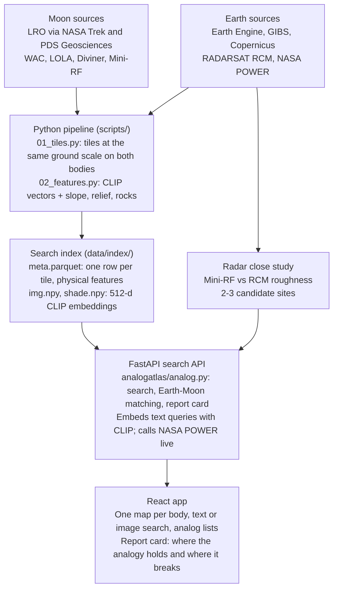
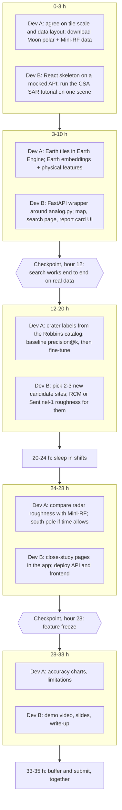

# AnalogAtlas — Plan & Status

As of 2026-11-14

## Overview

AnalogAtlas is a search engine for planetary analogs. You can type a description of an Earth landscape and find it on the Moon. Or you can pick a lunar site and get a ranked list of Earth analogs, each with a report card showing where the analogy holds and where it fails.

It answers the NASA Space Apps 2026 challenge on terrestrial analogs. The challenge asks teams to identify and characterize Earth locations that can stand in for future Moon-base or Mars landing sites. The judges stress three things:

- go beyond visual similarity
- surface analogs nobody has recognized yet
- say where each analog breaks down

Our approach has two stages:

1. **Global screening.** We split the Moon and Earth's land into tiles of about 85 × 85 km. Each tile gets a CLIP embedding (a vector describing what it looks like) and physical measurements: slope, relief, rock cover, temperature and dryness. Search runs across both bodies.
2. **Close study.** For the 2–3 strongest *new* candidates, we compare radar surface roughness: RADARSAT RCM or Sentinel-1 on Earth against LRO Mini-RF on the Moon. We add high-resolution imagery and slopes, and write a report card for each site.

Scope: the Moon first. Mars gets one slide showing that the same method applies.

## Status

The Moon search index is built and verified. The Earth side and the React app haven't been started.

| Piece | State | Notes |
| --- | --- | --- |
| Python environment | Done | Python 3.12 venv, PyTorch on the Apple GPU (MPS), open_clip, FAISS, rasterio |
| Moon tiles | Done | 5,376 tiles from 60°S to 60°N, each with an LROC WAC image and a LOLA hillshade |
| Moon physical features | Done | Slope, relief and elevation (LOLA); rock abundance and regolith-temperature anomaly (Diviner), per tile |
| Moon CLIP embeddings | Done | 512-d image vectors, plus hillshade vectors averaged over four 90° rotations |
| Earth side | Not started | Moving to Google Earth Engine. 2,294 GIBS fallback tiles are on disk but unused |
| Search API | Not started | The search logic is in `analogatlas/analog.py`; it needs a FastAPI wrapper |
| React frontend | Not started | Replaces the earlier Streamlit draft, which has been removed |
| Radar close study | Not started | Needs RCM / Sentinel-1 scenes and Mini-RF data |

**Verification.** Three text queries on the Moon index returned the expected terrain, and slopes measured independently from LOLA elevation data agree:

| Query | Top 6 results | Median slope of top 6 |
| --- | --- | --- |
| "a large impact crater with a central peak" | Craters, several with central peaks | 4.7° |
| "smooth flat dark lava plains" | Dark mare with wrinkle ridges | 0.4° |
| "rugged mountainous highlands" | Rough, heavily cratered highlands | 5.7° |

For comparison, the median slope across all Moon tiles is 3.9°. The ML results agree with independent elevation data, which is the first point to make on the slides.

## Data

All Moon data comes from LRO, through NASA Trek and the PDS Geosciences Node. Earth data will come from Earth Engine, Copernicus, JAXA and CSA.

| Dataset | Body | Source | Used for | Status |
| --- | --- | --- | --- | --- |
| LROC WAC global mosaic (tiles) | Moon | NASA Moon Trek | Image embeddings, display | On disk |
| LOLA hillshade (tiles) | Moon | NASA Moon Trek | Terrain-shape embeddings | On disk |
| LOLA LDEM_16 (1.9 km/px) | Moon | [PDS Geosciences — LRO](https://pds-geosciences.wustl.edu/missions/lro/) | Slope, relief, elevation | On disk |
| Diviner GDR L3 rock abundance, regolith temperature anomaly | Moon | [PDS Geosciences — Diviner](https://pds-geosciences.wustl.edu/missions/lro/diviner.htm) | Landing-hazard and surface-material features | On disk |
| LOLA / Diviner polar products | Moon | PDS Geosciences | South-pole extension | To do |
| Mini-RF radar (CPR) | Moon | PDS Geosciences — LRO | Radar roughness close study | To do |
| Copernicus DEM, Sentinel-1, Sentinel-2 | Earth | [Copernicus Data Space](https://dataspace.copernicus.eu/) or Earth Engine | Slope, radar roughness, imagery | To do |
| ASTER GDEM hillshade, Blue Marble | Earth | [NASA Worldview / GIBS](https://worldview.earthdata.nasa.gov/) | Terrain-shape and image embeddings | 2,294 fallback tiles |
| NASA POWER climatology | Earth | NASA POWER API | Temperature, precipitation, irradiance | Live API, nothing to download |
| RADARSAT Constellation Mission | Earth | [CSA open data](https://donnees-data.asc-csa.gc.ca/en/dataset/rcm), [SAR tutorial](https://github.com/asc-csa/Synthetic_Aperture_Radar_Tutorial) | Compact-pol radar, the closest match to Mini-RF | To do |
| ALOS PALSAR | Earth | [JAXA G-Portal](https://www.gportal.jaxa.jp/?lang=en) | L-band radar, shallow subsurface | Optional |
| ESA archives | Both | [ESA Open Science Data](https://opensciencedata.esa.int/) | Contents not checked yet | Not reviewed |

Accounts already registered: NASA Earthdata, Copernicus Data Space, JAXA G-Portal, CSA. Still needed: Google Earth Engine (non-commercial use, needs a Google Cloud project).

**Mars resource.** The USGS Astrogeology [Interactive Maps: Mars](https://astrogeology-usgs.hub.arcgis.com/pages/interactive-maps-mars) page is a resource from another challenge. It only shows its content in a browser, so its list of maps couldn't be read automatically. It's only useful for the "same method works for Mars" slide, for example to pull MOLA or CTX map services for one Mars site. It doesn't change the Moon-first scope.

## Architecture

The heavy processing runs once, offline, in Python. The React app only talks to a thin search API that loads an index of about 15 MB.



The API is the only part that runs Python while the app is in use, because text queries have to be turned into CLIP vectors. Everything else the frontend needs (tile images, coordinates, features) can be served as static files.

## Repo

Code: [FionaL7/AnalogAtlas](https://github.com/FionaL7/AnalogAtlas), branch `main`.

The pipeline is two scripts built on a small `analogatlas` package. Git ignores `data/` and `.venv/`, so each developer rebuilds them on their own machine.

| Path | What it does |
| --- | --- |
| `analogatlas/config.py` | Paths, tile scale (~85 km), data endpoints, CLIP model choice |
| `analogatlas/tiles.py` | Builds the Moon (Trek WMTS) and Earth (GIBS WMS) tile grids at the same ground scale and downloads the tiles |
| `analogatlas/rasters.py` | Reads PDS3 IMG files; per-tile slope, relief, rock abundance, temperature |
| `analogatlas/embed.py` | CLIP image and text embeddings; rotation-averaged hillshades; a set of prompt templates averaged for text |
| `analogatlas/analog.py` | Search, Earth–Moon matching, NASA POWER climate lookup, analog report card |
| `analogatlas/sites.py` | Known Earth analog sites (for tagging results "known" or "new") and Moon preset sites |
| `scripts/01_tiles.py` | Step 1: tile grids and tile download |
| `scripts/02_features.py` | Step 2: physical features and embeddings, saved to `data/index/` |

To set up and run on a new machine:

```bash
uv venv --python 3.12 && source .venv/bin/activate
uv pip install -r requirements.txt
# put ldem_16.*, dgdr_ra_avg_cyl_032_img.*, dgdr_st_avg_cyl_032_img.* in data/raw/ (URLs in README)
python scripts/01_tiles.py moon     # ~11k tile requests to NASA Trek
python scripts/02_features.py moon  # ~5 min on an M1
```

The outputs land in `data/index/`:
- `moon_meta.parquet`: one row per tile, with coordinates and physical features
- `moon_img.npy` and `moon_shade.npy`: 5,376 × 512 float16 embeddings, 5.5 MB each

These three files are all the search API needs.

## Plan

Dev A handles data and ML. Dev B handles the app and the radar close study. The hour-12 checkpoint must not slip.



If the hour-12 checkpoint slips, cut the south pole first, then fine-tuning. Keep the radar close study: it's our strongest answer to "beyond visual similarity".

## Next steps and open decisions

The next milestone is the Earth index. Every Earth–Moon feature in the app depends on it.

- [ ] Register Google Earth Engine (non-commercial use) with a Google Cloud project
- [ ] Earth pipeline in Earth Engine: tile grid, Copernicus DEM slope and relief, export a table
- [ ] Earth tile images (ASTER hillshade + imagery) and their CLIP embeddings
- [ ] FastAPI wrapper around `analogatlas/analog.py` with `/search`, `/analogs`, `/twins`, `/tile`
- [ ] React app skeleton against mocked API responses
- [ ] Run the CSA SAR tutorial on one RCM scene
- [ ] Download Mini-RF and the polar LOLA / Diviner products

**Decided:**
- Moon first, with Mars on one slide
- React frontend
- laptop + Earth Engine + Colab, no paid cloud

**Still open:**
- **South pole:** should-have or stretch goal? We're leaning towards should-have, after the radar close study.
- **React map library:** MapLibre (one map per body) or Leaflet? Leaflet handles Trek's EPSG:4326 Moon tiles out of the box.
- **Hosting:** frontend on Vercel or GitHub Pages; API on Hugging Face Spaces, where the ~15 MB index fits easily.
