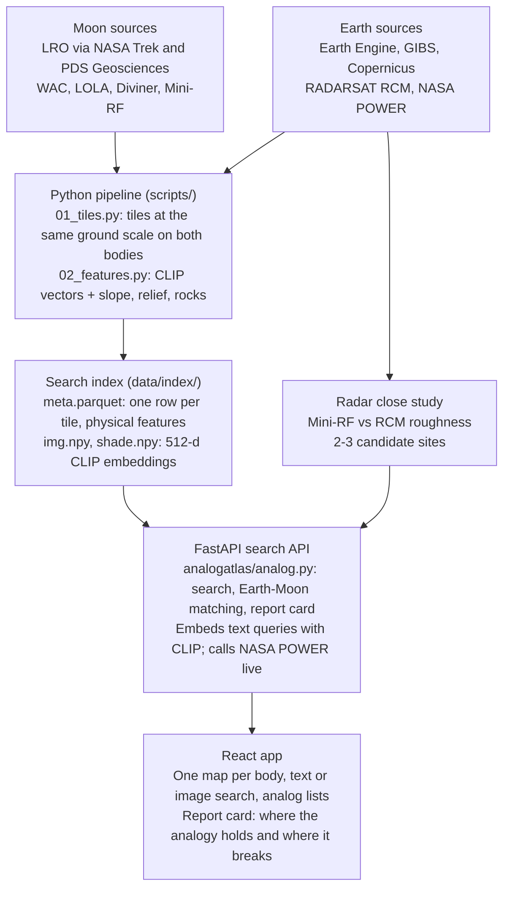

# AnalogAtlas — Plan & Status

As of 14 Nov 2026. Related docs:
- [BRIEF.md](BRIEF.md): the challenge text
- [REQUIREMENTS.md](REQUIREMENTS.md): requirements and the submission checklist
- [RESOURCES.md](RESOURCES.md): data sources

## Overview

AnalogAtlas is a search engine for planetary analogs. You can describe an Earth landscape and find matching terrain on the Moon, or pick a lunar site and get a ranked list of Earth analogs. Each analog comes with a report card showing where the analogy holds and where it breaks down.

It answers the NASA Space Apps 2026 challenge *Identify Earth Locations that Analog the Permanent Moon Base Locations and Mars*. The judges stress three things, and each has a matching part of our design:

| Judges want | How we answer |
| --- | --- |
| Go beyond visual similarity | CLIP finds terrain that looks alike; slope, relief, rock cover, temperature and radar roughness check whether it really is alike |
| New, unrecognized analogs | Results near well-known analog sites are tagged "known" (`analogatlas/sites.py`); we lead with the untagged ones |
| Say where it breaks down | Every analog gets a report card: dimension by dimension, holds or breaks |

There are two stages:

1. **Global screening.** We split the Moon and Earth's land into tiles of about 85 × 85 km. Each tile gets CLIP embeddings (vectors describing what it looks like) and physical measurements, and search runs across both bodies.
2. **Close study.** For the 2–3 strongest *new* candidates, we compare radar surface roughness (RADARSAT RCM or Sentinel-1 on Earth, LRO Mini-RF on the Moon), add high-resolution imagery and slopes, and write a full report card.

Scope: the Moon first. How much Mars gets is an [open decision](#open-decisions).

## Status

The Moon search index (60°S to 60°N) is built and verified. The Earth side, the API and the app haven't been started.

| Piece | State | Notes |
| --- | --- | --- |
| Python environment | Done (Dev A's Mac) | Python 3.12, PyTorch on the Apple GPU (MPS), open_clip, FAISS, rasterio |
| Moon tiles | Done | 5,376 tiles from 60°S to 60°N, each with an LROC WAC image and a LOLA hillshade |
| Moon physical features | Done | Slope, relief and elevation (LOLA); rock abundance and regolith-temperature anomaly (Diviner) |
| Moon CLIP embeddings | Done | 512-d image vectors, plus hillshade vectors averaged over four 90° rotations |
| Moon south pole (> 60°S) | Not started | **Where candidate Moon-base sites are.** See [open decisions](#open-decisions) |
| Earth side | Not started | Moving to Google Earth Engine. A working fallback path (GIBS tiles + ETOPO elevation) is in the code; 2,294 of its ~11.7k tiles are on Dev A's disk |
| Search API | Not started | The search logic is in `analogatlas/analog.py`; it needs a FastAPI wrapper |
| React frontend | Not started | Replaces an earlier Streamlit draft, which has been removed |
| Radar close study | Not started | Needs RCM or Sentinel-1 scenes and Mini-RF data |
| Mars | Not started | |

**Verification.** Three text queries on the Moon index returned the expected terrain, and slopes measured independently from LOLA elevation data agree:

| Query | Top 6 results | Median slope of top 6 |
| --- | --- | --- |
| "a large impact crater with a central peak" | Craters, several with central peaks | 4.7° |
| "smooth flat dark lava plains" | Dark mare with wrinkle ridges | 0.4° |
| "rugged mountainous highlands" | Rough, heavily cratered highlands | 5.7° |

For comparison, the median slope across all Moon tiles is 3.9°. The ML results agree with independent elevation data, which is the first point to make on the slides.

## Challenge fit

Requirements, judging criteria, dimension coverage, things to avoid and the submission checklist are all in [REQUIREMENTS.md](REQUIREMENTS.md). The biggest gap: **"permanent Moon base" means the lunar south pole.** NASA's Artemis candidate landing regions are all near the south pole, and our index stops at 60°S. See [open decisions](#open-decisions).

## Time and team

The event runs **14–15 Nov 2026**. We have **36 hours** to finish, and it has already started.

| | Dev A: data and ML | Dev B: app and radar |
| --- | --- | --- |
| First | Earth index (Earth Engine): tiles, slope and relief, embeddings | FastAPI wrapper around `analog.py`; React skeleton on a mocked API |
| Then | South pole (if decided) or crater labels from Robbins + precision@k | Pick 2–3 new candidates; RCM or Sentinel-1 roughness vs Mini-RF |
| Last | Accuracy charts, limitations | Close-study pages, deploy, demo (≤30 s video or ≤7 slides), write-up |

**Milestones**, in order:
1. Search works end to end on real data, Earth and Moon. This is the critical milestone; everything else builds on it.
2. Close study done for 2–3 sites.
3. Feature freeze, then the demo, slides and write-up.
4. Submit together, leaving a buffer before the deadline: **Sun 15 Nov, 11:59 p.m.** local time of our Local Event. Follow the [submission checklist](REQUIREMENTS.md#5-deliverable-checklist-space-apps-submission).

If we fall behind, cut fine-tuning first. Keep the radar close study: it's our strongest answer to "beyond visual similarity".

## Architecture

The heavy processing runs once, offline, in Python. The React app only talks to a thin search API that loads an index of about 15 MB.



The API is the only part that runs Python while the app is in use, because text queries have to be turned into CLIP vectors. Everything else the frontend needs (tile images, coordinates, features) can be served as static files.

## Repo

Code: [FionaL7/AnalogAtlas](https://github.com/FionaL7/AnalogAtlas), branch `main`.

The pipeline is two scripts built on a small `analogatlas` package. Git ignores `data/` and `.venv/`, so each developer rebuilds them on their own machine.

| Path | What it does |
| --- | --- |
| `analogatlas/config.py` | Paths, tile scale (~85 km), data endpoints, CLIP model choice |
| `analogatlas/tiles.py` | Builds the Moon (Trek WMTS) and Earth (GIBS WMS) tile grids at the same ground scale and downloads the tiles |
| `analogatlas/rasters.py` | Reads PDS3 IMG files and ETOPO; per-tile slope, relief, rock abundance, temperature |
| `analogatlas/embed.py` | CLIP image and text embeddings; rotation-averaged hillshades; text prompts averaged over templates |
| `analogatlas/analog.py` | Search, Earth–Moon matching, NASA POWER climate lookup, analog report card |
| `analogatlas/sites.py` | Known Earth analog sites (to tag results "known" or "new") and Moon and Earth preset sites |
| `scripts/01_tiles.py` | Step 1: tile grids and tile download |
| `scripts/02_features.py` | Step 2: physical features and embeddings, saved to `data/index/` |

### Setup on a new machine

Put the raw rasters in `data/raw/` first (download URLs are in the [README](../README.md)). PyTorch picks the device: Apple GPU (MPS) on a Mac, CUDA on an NVIDIA GPU, otherwise CPU (slower, but fine for 5k tiles).

#### Linux / macOS

```bash
uv venv --python 3.12
source .venv/bin/activate
uv pip install -r requirements.txt
python scripts/01_tiles.py moon     # ~11k tile requests to NASA Trek
python scripts/02_features.py moon  # ~5 min on an M1
```

#### Windows

In PowerShell:

```powershell
uv venv --python 3.12
.venv\Scripts\Activate.ps1
uv pip install -r requirements.txt
python scripts\01_tiles.py moon
python scripts\02_features.py moon
```

If HTTPS downloads fail with a certificate error, the Windows certificate store is probably missing a root that a data host relies on. We saw this with spaceappschallenge.org.

The outputs land in `data/index/`:
- `moon_meta.parquet`: one row per tile, with coordinates and physical features
- `moon_img.npy` and `moon_shade.npy`: 5,376 × 512 float16 embeddings, 5.5 MB each

These three files are all the search API needs.

## Next steps

The next milestone is the Earth index. Every Earth–Moon feature in the app depends on it.

- [ ] Decide the south-pole and Mars questions below
- [ ] Register Google Earth Engine (non-commercial use) with a Google Cloud project
- [ ] Earth pipeline in Earth Engine: tile grid, Copernicus DEM slope and relief, export a table
- [ ] Earth tile images (ASTER hillshade + imagery) and their CLIP embeddings
- [ ] FastAPI wrapper around `analogatlas/analog.py` with `/search`, `/analogs`, `/twins`, `/tile`
- [ ] React app skeleton against mocked API responses
- [ ] Run the CSA SAR tutorial on one RCM scene
- [ ] Download Mini-RF and the polar LOLA / Diviner products
- [ ] Add the fixed "Earth's limits" rows to the report card in `analog.py`

## Decisions

**Decided:**
- Moon first
- React frontend
- Laptop + Earth Engine + Colab, no paid cloud
- Two developers: Dev A (data and ML), Dev B (app and radar)

### Open decisions

- **South pole: stretch goal, or core scope?** The challenge title asks for analogs of *permanent Moon-base locations*. Artemis candidate base sites are all near the lunar south pole, and our index stops at 60°S. Without the pole, the demo answers "Earth analogs for lunar terrain", not "for Moon-base sites". **Recommendation: make it core.** Add polar LOLA and Diviner tiles (polar stereographic, so a separate grid) and the Artemis candidate regions as Moon presets. Compare on the dimensions a base cares about: illumination, cold traps and ice, slope, and Earth permafrost or polar-desert analogs. If we fall behind, cut fine-tuning instead.
- **How much Mars?** The title gives Mars equal billing ("future Mars landing and exploration sites"). Options: one slide showing the method transfers, or a small Mars index (MOLA plus CTX or THEMIS tiles) with the same search on 2–3 Mars landing sites.
- **React map library:** MapLibre (one map per body) or Leaflet? Leaflet handles Trek's EPSG:4326 Moon tiles out of the box; the polar tiles would need a separate projection either way.
- **Hosting:** frontend on Vercel or GitHub Pages; API on Hugging Face Spaces, where the ~15 MB index fits easily. The free domain and cloud credits in the [Global Offers](RESOURCES.md#global-offers-optional-free-tools) are also options.
- **Sharing large data:** `data/` isn't in git and can reach GBs. Options: a Hugging Face dataset repo, Google Cloud Storage (Global Offer credit), Google Drive, or GitHub Release files (2 GB per file).
- **Deployment (later):** an agent deploys from a PR, or a CI/CD pipeline.
